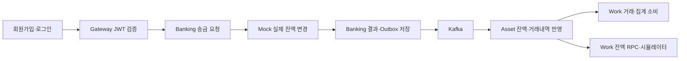

# MOAJE 종합 통합 테스트 계획

**최신 재검증은 [2026-10-11 결과](integration-test-results-20261011.md)를 참고한다. 아래는 10월 10일 당시의 규격·실행 이력이며, 현재 가입은 휴대폰 번호와 PIN 기준이다.**

상태: 2026-10-10 사용자 승인 후 격리 환경에서 실행. 가입은 현행 email + 6자리 PIN 기준이며 SMS는 제외했다.
최신 r3 결과: Asset `ba67f54` 커밋·push 후 Banking `ee36b69`와 Mock 오류 코드 변경을 재빌드했다. 검증 기록 159건 중 157건 통과, Auth 타인 계좌 토큰 발급·Work 집계 전 프로필 조회 2건 실패다. 이전 Banking Timeout 오분류와 Asset 500 응답은 이번 조건에서 해결됨을 확인했다. Timeout은 UNKNOWN → 대사 1회 → SUCCEEDED → 성공 Outbox → Asset 거래 1건으로 복구됐다. 실제 403·404 ProblemDetail 응답도 확인했다.
[최신 수정 후 PDF 결과](../output/pdf/moaje-integration-retest-fixed-20261010.pdf). `moaje-e2e-20261010-r3`의 컨테이너·볼륨·인증서는 제거했고 기존 개발 볼륨 7개는 보존했다. 아래 r2 결과는 수정 전의 역사적 기록이다.

재시험 결과: Banking 인증 바인딩 수정(`d7b0b68`) 후 정상 송금 → Outbox → Asset → Work 경로가 통과했다. Kafka 중단 후 재발행과 Banking 종료 후 오래된 PROCESSING 복구도 확인했다. 다만 Mock 성공 응답 Timeout이 Banking FAILED로 확정되는 문제가 남아 있다. Auth 타인 사용자 계좌 토큰 발급, Asset 오류 응답 500, Work 집계 전 소비 프로필 500도 발견했다.
[새 PDF 결과](../output/pdf/moaje-integration-test-report-20261010.pdf)에 실행 기록과 미검증 항목을 구분했다. 이전 PDF는 대체했다. 테스트 프로젝트는 `moaje-e2e-20261010-r2`, Gateway는 `19080`을 사용했으며 종료 후 테스트 컨테이너·볼륨을 삭제했다. 기존 개발 볼륨은 보존했다.
기준: 2026-10-10 로컬 소스. Work는 `dev / 0f73ea5`. 미커밋 변경을 포함한 저장소와 실제 이미지 ID는 PDF에 기록했다. 이번 시험에서는 업무 소스를 수정하지 않았다.

## 1. 무엇을 확인하는가

단순히 HTTP 200이 나오는지가 아니라, 실제 돈의 이동과 각 서비스의 기록이 일치하는지 확인한다.

외부 거래는 `Mock 거래 생성 → Asset refresh/정기 동기화 → Banking 스냅샷 → Asset → Work`라는 별도 흐름으로 검사한다.

재시험에서 Auth·Banking·Asset·Work의 실행 OpenAPI를 수집했다. 아래는 시험 계획이며, 실제 실행한 조건과 결과는 PDF의 개별 검증 기록을 기준으로 한다. API 등록 여부와 모든 입력·권한·장애 조건의 검증은 구분한다.

## 2. HTTP API 목록

사용자 API의 기준 주소는 Gateway `http://localhost:8080`이다. `{u}`는 로그인한 사용자 ID, `{a}`는 Banking 내부 계좌 ID, `{t}`는 Asset 거래내역 ID다. 각 항목은 정상·잘못된 입력·인증·타인 접근을 검사한다.

### Auth

Gateway의 `/api/v1/auth`는 Auth 내부 `/api/auth`로 변환된다.

| Method | Gateway 경로 | 확인 내용 |
|---|---|---|
| POST | `/api/v1/auth/register` | PIN 가입, 중복 가입, 잘못된 입력 |
| POST | `/api/v1/auth/login` | 로그인, 잘못된 PIN, JWT 발급 |
| POST / GET | `/api/v1/auth/token/validate` | 본문/헤더 토큰 유효성 |
| POST | `/api/v1/auth/refresh` | refresh 교체, 이전 refresh 재사용 거절 |
| POST | `/api/v1/auth/logout` | 로그아웃 후 refresh 거절; access JWT 무효화 여부는 별도 확인 |
| POST | `/api/v1/auth/account-token` | 계좌 토큰 발급, 타 사용자 ID 지정 시 차단 여부 |
| POST | `/api/v1/auth/account-token/validate` | 정상·변조·없는 계좌 토큰 |

현재 로컬 Auth 라우터에는 SMS·약관·온보딩 전용 HTTP API가 없다. 다른 브랜치에 존재할 가능성은 별도 확인하며, 지원한다고 가정하지 않는다.

### Banking·Asset

| Method | 경로 | 확인 내용 |
|---|---|---|
| POST | `/api/v1/banking/accounts` | Mock 계좌 생성, Banking 연결 정보, Asset 계좌 생성 이벤트 |
| POST | `/api/v1/banking/transfers` | 송금, 키 필수·동일 요청 재사용·충돌·소유권 |
| GET | `/api/v1/assets/accounts/{a}/detail` | 계좌 상세와 캐시 |
| GET | `/api/v1/assets/accounts/{a}/transactions` | 최초 커서 생략, 50건, nextCursor, 마지막 페이지 |
| GET | `/api/v1/assets/accounts/{a}/{t}/transaction` | 단건 조회, 다른 계좌의 거래 ID 차단 |
| POST | `/api/v1/assets/accounts/{a}/refresh` | Mock 최신 잔액·계좌 상태·거래 수집, 반복 실행 중복 방지 |
| POST | `/api/v1/assets/cashflow/daily-limit` | 하루 사용 가능액, 일수 검증, 계좌 없음·비활성·0원, 캐시 갱신 |
| GET | `/api/v1/assets/cashflow/monthly?yearMonth=YYYY-MM` | 월별 수입·지출·자금 이동 |
| GET | `/api/v1/assets/cashflow/category?yearMonth=YYYY-MM` | 월별 카테고리 집계 |

### Work

아래 경로 앞에는 모두 `/api/v1/work`를 붙인다. AI 설명의 문장 자체보다 금액·사용자·월·revision·응답 구조를 검사한다.

| Method | 경로 | 기능 |
|---|---|---|
| GET | `/onboarding/questions` | 문항 목록 |
| POST | `/onboarding/{u}/answers` | 여러 답변 저장 |
| POST | `/onboarding/{u}/answers/{question_no}` | 단일 답변 저장·수정 |
| GET | `/onboarding/{u}/answers`, `/onboarding/{u}/progress`, `/onboarding/{u}/profile` | 답변·진행률·미래 카드 |
| GET | `/simulator/baselines` | 비용 기준 |
| POST | `/simulator/{u}/simulate`, `/simulator/{u}/adjust` | 현재 잔액 기반 계산·조건 변경 |
| POST | `/readiness/{u}` | 사회인 준비도 |
| GET | `/recap/{u}/months`, `/recap/{u}/{year_month}` | 월 목록·Money Recap |
| GET | `/spending/{u}/event-buffer`, `/spending/{u}/profile`, `/spending/{u}/report` | 일정 예산·소비 프로필·학기 리포트 |
| POST | `/spending/schedule` | 수동 일정 등록 |
| GET | `/spending/{u}/schedules` | 수동/등록 일정 조회 |
| GET | `/calendar/universities`, `/calendar/{u}/schedules` | 학교·전체 일정 |
| POST | `/calendar/sync` | 학교·학기 일정 동기화, 수동 일정 보존 |
| POST | `/fds/detect` | 이상거래 탐지 |
| GET | `/fds/{u}/blacklist`, `/fds/{u}/logs`, `/fds/{u}/alerts`, `/fds/{u}/safety-score` | 차단 여부·탐지·알림·안전도 |
| PATCH | `/fds/{u}/alerts/{alert_id}/confirm` | 본인 알림 확인, 타인 알림 차단 |
| POST | `/fds/blacklist` | 운영자 전용 등록 |
| DELETE | `/fds/{u}/blacklist` | 운영자 전용 해제 |
| GET | `/metrics/retention` | 운영자 전용 재방문 지표 |

운영자 API는 내부 토큰 설정을 확인한 뒤 실행한다. 미설정 상태의 차단 검증과 정상 운영자 기능 검증은 별개다.

### Mock·내부 RPC·운영 기능

Mock은 Gateway 사용자 API가 아니다. 테스트 준비·원본 결과 확인용으로 `localhost:8081`에 요청하며 HMAC·Mock 토큰 인증을 사용한다.

| 구분 | 계약 | 확인 내용 |
|---|---|---|
| Mock POST | `/oauth/2.0/token` | 모의 계정계 인증 |
| Mock POST / GET / DELETE | `/api/accounts`, `/api/accounts/{accountNumber}` | 계좌 생성·조회·해지 |
| Mock GET | `/api/accounts/{accountNumber}/histories` | 원본 거래내역 |
| Mock GET | `/api/accounts/providers/{providerAccountId}/snapshot` | 잔액·상태·거래 스냅샷 |
| Mock POST | `/api/accounts/{accountNumber}/withdrawals` | 외부 지출·가맹점 내역 |
| Mock POST / GET | `/api/transfers`, `/api/transfers/{clientTransferId}` | 원거래·결과 조회, 동일 ID 중복 방지 |
| Mock POST | `/api/transfers/{clientTransferId}/reverse` | 기존 반전 모델 회귀 검사용. 일반 시나리오 제외 |
| Mock POST | `/internal/test-fixtures/personas` | local/test 전용 다개월 페르소나 생성 |
| Asset RPC | `GetCurrentBalance`, `GetDailyCashflow` | 잔액 조회와 일별 계산 계약 분리·오류 매핑 |
| Banking RPC | `GetTransferProjectionStates`, `GetAccountProjectionSnapshot` | Asset 복구 조회·스냅샷, mTLS·계좌 소유자 대응 |
| 기타 RPC | Auth·Work의 공통 proto 선언 | 실제 서버 구현·호출처 확인 후 지원 기능만 추가 검사. 선언만으로 구현 완료로 보지 않음 |
| 내부 작업 | Outbox·대사·월 집계 스케줄러 | API 외 기능도 DB 상태·Kafka 결과로 검증 |

Mock에 계좌 동결 전용 HTTP API나 일반 입금 전용 API가 있다고 가정하지 않는다. 동결 상태·외부 입금 시험은 지원되는 fixture 또는 별도 격리 준비 방법부터 확인한다.

## 3. 실행할 시나리오

### A. 정상 흐름: 먼저 실행

| ID | 시나리오 | 통과 기준 |
|---|---|---|
| A01 | 실제 회원가입·로그인 → Gateway 인증 | 사용자 2명 가입·로그인, 잘못된 토큰·위조 내부 헤더 거절 |
| A02 | 송금인 100,000원·수취인 0원 계좌 개설 | Mock·Banking 연결 정보·Asset 계좌 일치. 계좌 생성 이벤트 확인 |
| A03 | 송금인 → 수취인 10,000원 송금 | Mock 90,000/10,000원, Banking SUCCEEDED, 외부 ID 기록, Outbox PUBLISHED |
| A04 | Kafka → Asset → Work 후속 처리 | 송금인 Asset 90,000원·출금 기록 1건, 성공 이벤트 Work 소비. 수취인 10,000원은 refresh/스냅샷 경로까지 확인 |
| A05 | 같은 송금 키 재요청·금액 변경·키 누락 | 같은 transferId·추가 출금 없음, 다른 본문 409, 키 누락 4xx |
| A06 | 잔액 부족·타인 출금계좌·없는 계좌·잘못된 금액 | 명확한 거절, 실제 잔액 불변, 실패와 UNKNOWN 구분 |
| A07 | 상세·단건·50건 페이지 조회 | 120건 이상 준비 후 50/50/나머지, 중복·누락 없음. 타인 계좌·다른 계좌 거래 차단 |
| A08 | Mock 외부 가맹점 거래 → refresh 두 번 | 거래 수집·카테고리 분류·최신 잔액 일치, 재조회 후 중복 없음 |
| A09 | 정기 스냅샷 동기화 | 수동 refresh 없이 외부 거래 반영. 활성화 설정·주기 확인 후 제한 시간 내 관찰 |
| A10 | 일별 한도·잔액 전용 RPC | ACTIVE 합계만 사용. 0원 정상, 계좌 없음/비활성 오류, 0일 거절. 잔액·입력 변경 시 캐시 재계산 |
| A11 | 다개월 월별·카테고리 집계 | 개인 간 이체는 TRANSFER로 분리. 가맹점 지출·월 경계·0원 사용자 집계 확인 |
| A12 | 월 집계 Outbox → Work·늦은 전월 거래 | 실제 Asset 발행 확인. 늦은 거래 후 revision 증가, Work 최신 값 유지·원래 발생월 보존 |
| A13 | Work 온보딩 → 시뮬레이터 → 준비도 | 10문항 저장·진행률·수정 반영, Asset 실제 잔액 사용, 조건 변경 결과 검증 |
| A14 | Work 소비 프로필·Recap·일정 | 월 데이터 조회, 수동 일정·자동 동기화·재동기화, 다른 학기 및 수동 일정 보존 |
| A15 | Work FDS·운영 API·지표 | 탐지·로그·알림 확인·타인 차단. 내부 토큰 없을 때 차단, 설정 시 등록·해제·지표 결과 |
| A16 | 토큰 교체·로그아웃·계좌 토큰 | 이전 refresh 재사용 거절, 계좌 토큰 변조·다른 사용자 접근 확인 |

수취인 입금은 송금인 출금 이벤트와 같은 경로라고 가정하지 않는다. 현재 Banking Completed 이벤트는 출금 계좌 ID를 담으므로 수취 계좌의 스냅샷 수집까지 별도로 확인한다.

### B. 중복·장애·복구: 정상 흐름 통과 후 실행

| ID | 시나리오 | 통과 기준·준비 |
|---|---|---|
| B01 | 같은 키 동시 송금·서로 다른 키 동시 출금 | 거래 행·Mock 실행 횟수·실제 잔액 검증. 잔액 초과 출금 방지 |
| B02 | 성공 이벤트 중복·다른 eventId의 같은 거래 | Asset 거래 효과·Work 거래 기록 1회 |
| B03 | 스냅샷 먼저 / 이벤트 먼저 | 두 순서 모두 외부 ID·transferId 연결, 중복 잔액 변경·거래 생성 없음 |
| B04 | Kafka 중단 → 송금 성공 → Kafka 복구 | Mock 성공·Banking 결과 보존, Outbox PENDING·attempt 증가, 복구 후 소비 |
| B05 | Kafka ack 후 PUBLISHED 저장 전 종료 | 동일 eventId 재발행 가능, Asset 중복 효과 없음. 정확한 중단 지점용 테스트 장치 필요 |
| B06 | Outbox 재시도 소진·Lease 만료 | RETRY_EXHAUSTED 보존, 동시 claim 방지, 종료된 Publisher 선점 회수. 수동 재발행 API 존재 여부부터 확인 |
| B07 | Mock 처리 성공·응답 Timeout | UNKNOWN → 외부 결과 조회 → SUCCEEDED → Outbox·Asset 복구. 정확한 응답 지연 주입 장치 필요 |
| B08 | Mock 성공 후 Banking 결과 저장 전 종료 | 오래된 PROCESSING 대사로 복구, 중복 송금 없음. 정상 진행 중 PROCESSING은 선점하지 않음 |
| B09 | 대사 조회 장애·재시도 소진·Lease 만료 | attempt·다음 시각·소진 상태·metric 확인, 재조회 실패를 원거래 FAILED로 오판하지 않음 |
| B10 | Asset 일시 DB 장애·손상된 Protobuf·DLT 실패 | 제한 재시도, DLT 추적 정보, DLT 발행 실패 시 원본 성공 처리 금지 |
| B11 | SYNC_REQUIRED → 자동 복구·재소비 | 계정계/Banking 결과와 대사, 장부 복구, 재소비해도 중복 없음. transferId 없는 손상 이벤트는 계좌 헤더 기반 복구 가능 범위 구분 |
| B12 | Work 중단 → 실제 Asset 이벤트 발행 → Work 복구 | 거래·집계 따라잡기, 최신 revision 유지. Consumer 오류 시 offset 정책도 관찰 |

Mock의 `X-Mock-Scenario`는 존재하지만 Banking이 그 헤더를 전달하는 코드는 확인되지 않았다. 또한 기본 지연은 5초, Banking readTimeout은 30초여서 헤더만으로 B07을 재현했다고 볼 수 없다. 테스트 전용 프록시/격리 실행 중 어떤 방법을 쓸지 먼저 정하고 Production API에 장애용 입력을 추가하지 않는다.

이미 발생한 REVERSED의 회귀 검사는 별도 선택 항목이다. 사용자가 제외한 반전 실행 정책을 새로 도입하거나 일반 사용자 송금 시나리오에 섞지 않는다.

## 4. 테스트 데이터·판정·정리

1. 별도 Compose 프로젝트·전용 볼륨·충돌 없는 포트로 격리하는 방식을 권장한다. 현재 개발 데이터는 삭제하지 않는다.
2. 가짜 사용자 2명, 미연동/0원/비활성 사용자, 다개월 소비 페르소나를 준비한다. 정상 흐름의 원장은 반드시 Mock API/fixture에서 생성한다. Asset 거래 INSERT로 우회하지 않는다.
3. 요청·응답에서 JWT·CI·전화번호·계좌번호를 가린다. transferId·eventId·외부 거래 ID의 대응과 금액·DB 행 수·상태·Kafka offset을 증거로 남긴다.
4. 비동기 처리는 무조건 sleep하지 않고 제한 시간 내 상태를 반복 조회한다. 매월 1일까지 기다리지 않고 테스트용 실행 방식으로 집계 작업을 호출한다. 공개 집계 실행 API가 있다고 가정하지 않는다.
5. 각 항목을 PASS / FAIL / BLOCKED / NOT RUN으로 기록한다. AI 외부 모델·학교 기초 데이터·운영 토큰 등이 없으면 BLOCKED로 남긴다.
6. 실패 시 로그·상태를 먼저 보관한다. 승인된 테스트 프로젝트에 속한 볼륨만 정리한다. Kafka는 특정 사용자 메시지만 안전하게 삭제하기 어려우므로 격리 Kafka를 함께 폐기한다.

DB 결과 저장 직전 종료, ack 직후 종료, 다중 Worker Lease 시험은 Swagger만으로 정확히 재현할 수 없다. 기존 자동화 테스트를 함께 실행하고, 실제 컨테이너 장애 검증과 결과를 분리한다. 필요한 주입 장치 변경은 범위 확인 후 진행한다.

## 5. 승인할 실행 범위

- 1차: 전용 테스트 환경 준비 및 A01~A16. 외부 의존성이 없는 항목부터 실행한다.
- 2차: B01~B12. 테스트 환경 안에서만 Kafka·서비스 중단/재시작을 허용한다. 정확한 중단 지점 시험은 장치 준비 여부를 보고한다.
- 일반 반전 실행 및 실제 SMS 발송은 제외한다. 기존 개발 볼륨 삭제·업무 코드 수정·커밋·푸시는 이번 테스트 승인에 포함하지 않는다.

## 코드 근거

- API: Banking `account/web/AccountController.kt`, `transfer/web/TransferController.kt`; Asset `account/web/AccountController.kt`, `cashflow/web/*Controller.kt`.
- Auth: `moaje-auth/app/api/auth.py`; Work: `moaje-work/app/api/v1/router.py`, `endpoints/*.py`.
- 이벤트: `moaje-banking/.../transfer/messaging/publisher/BankingTransferEventPublisher.kt`.
- 장애 주입: `backing-mockup/.../auth/presentation/HmacAndTokenInterceptor.kt`; 외부 Timeout: `moaje-banking/src/main/resources/application.yml`.
- 연동 경로: `moaje-infra/moajeGateway/src/main/resources/application.yaml`, `docker-compose.yaml`; RPC: `moaje-grpc-contracts/proto/grpc/*.proto`.
